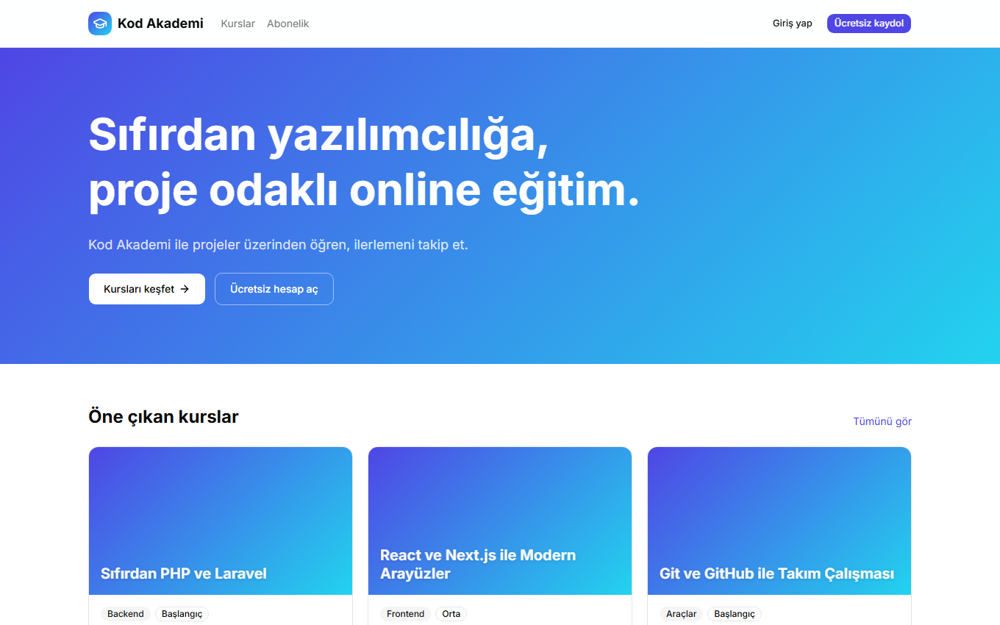
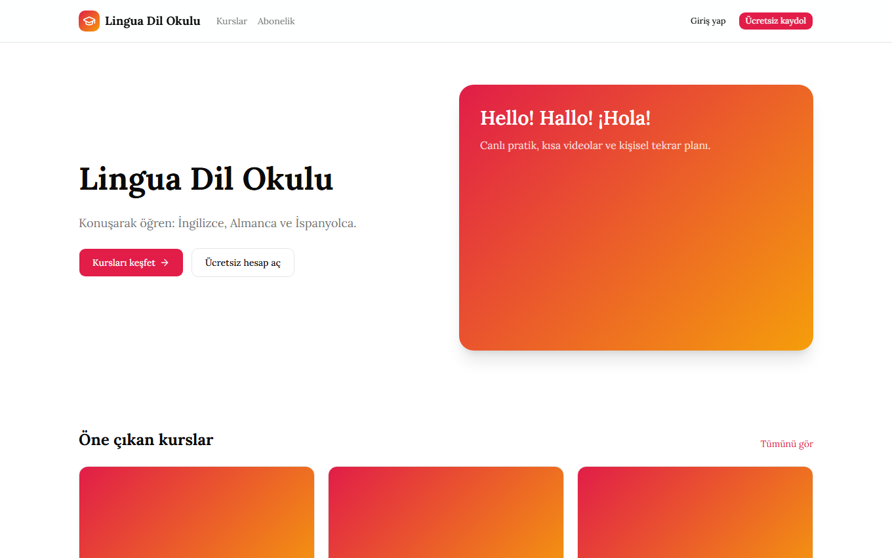
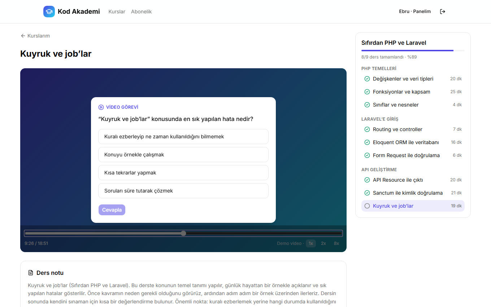
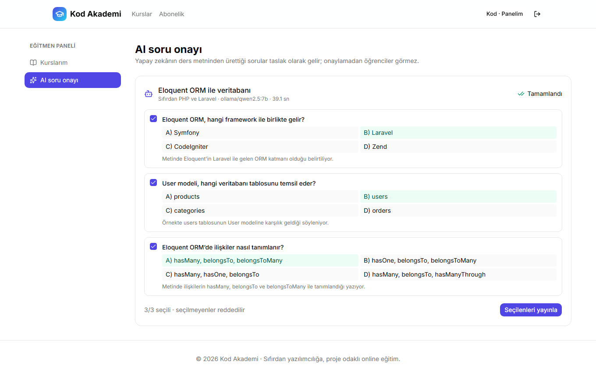
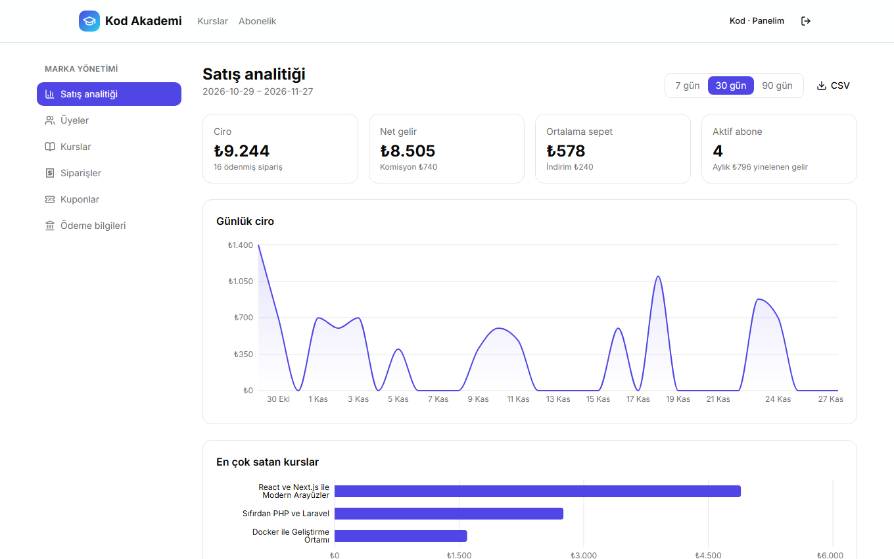
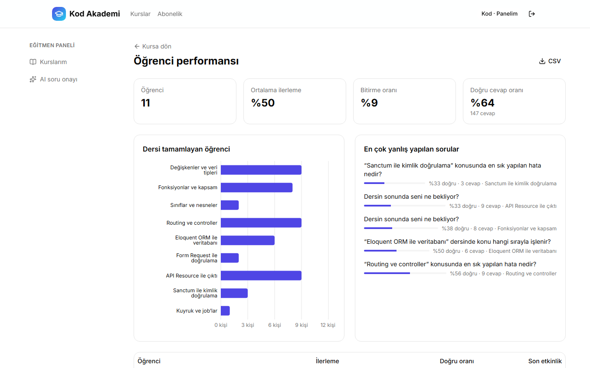
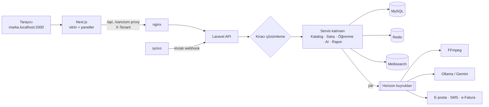

# Edu SaaS Platform

[](https://github.com/CeyDrew/edu-saas-platform/actions/workflows/ci.yml)

Birden fazla eğitim markasının (kurs, dershane, online akademi) tek altyapıdan yönetildiği, yapay zekâ destekli, çok kiracılı (multi-tenant) bir eğitim platformu.

Her marka kendi alt alan adında, kendi teması, kurs kataloğu, öğrencileri ve satış sayfasıyla çalışır. Platform sahibi tüm markaları, satışları ve komisyonları tek panelden yönetir.

| | |
|---|---|
|  |  |
|  |  |
|  |  |

Diğer ekranlar: [docs/screenshots](docs/screenshots).

## Özellikler

**Markalar (multi-tenancy)**
- Tek veritabanı + `tenant_id`; global scope ile otomatik filtreleme, kiracı bağlamı kuyruk job'larına taşınır.
- Marka alt alan adından çözülür (`kodakademi.localhost`); renk, yazı tipi ve açılış sayfası düzeni markaya özel.
- Her model için otomatik çalışan kiracı izolasyon testi.

**Roller**: platform yöneticisi, marka yöneticisi, eğitmen, öğrenci. Sanctum ile tarayıcı için çerez oturumu, diğer istemciler için token.

**Katalog**: kurs, bölüm, ders; kapak görseli ve video yükleme, kuyrukta FFmpeg ile süre ve küçük resim çıkarma, Meilisearch ile yazım hatasını tolere eden arama (marka başına ayrı indeks).

**Satış**
- iyzico Checkout Form (sandbox); anahtar tanımlı değilse aynı akışı izleyen yerel test ödeme sayfası.
- İmzalı webhook doğrulama, idempotency (aynı bildirim ikinci kez işlenmez), sipariş satırı kilitlenerek ödendi işaretleme.
- Aylık abonelik: saklı kartla otomatik yenileme, başarısız ödemede 3 deneme, ardından erişimin askıya alınması.
- Kupon (yüzde / sabit tutar, kullanım limiti, son tarih), platform komisyonu.
- Fatura bilgisinde TCKN ve VKN, marka ödeme hesabında IBAN, kontrol haneleriyle doğrulanır ([laravel-tr-validation](https://github.com/CeyDrew/laravel-tr-validation)). E-Arşiv / e-Fatura entegratör arayüzü arkasında.
- Sipariş onayı e-posta ve SMS ile (yerelde Mailpit ve log sürücüsü).

**Öğrenme**
- Video görevleri: videonun belirli saniyesinde oynatıcı durur ve soru sorar.
- İzlenme takibi gerçek izleme süresine göre (ileri sarmak dersi tamamlamaz); %90'da ders tamamlanır.
- Ders sonu değerlendirmesi, yanlış soru arşivi ve SM-2 aralıklı tekrar ile günlük tekrar listesi.

**Yapay zekâ**
- Eğitmen ders metninden veya transkriptten çoktan seçmeli soru ürettirir. Varsayılan sağlayıcı yerel Ollama; `GEMINI_API_KEY` tanımlıysa Gemini.
- Model çıktısı JSON şemasıyla zorlanır ve sunucuda yeniden doğrulanır; geçersiz çıktı bir kez hata mesajıyla tekrar denenir, yine geçersizse hiçbir şey kaydedilmez.
- Üretilen sorular taslaktır; eğitmen onaylamadan öğrenciler görmez.
- Öğrenciye yanlış arşivinden kişisel çalışma önerisi.

**Raporlama**: marka satış analitiği (ciro, net gelir, günlük seri, en çok satanlar, abonelik geliri), kurs bazında öğrenci performansı (ilerleme, bitirme, en çok yanlış yapılan sorular), platform geneli ciro ve komisyon. Tümü Excel uyumlu CSV olarak indirilebilir.

## Mimari



| Katman | Teknoloji |
|---|---|
| API (`api/`) | Laravel 13, PHP 8.4, MySQL 8.4, Redis, Sanctum, Horizon, Scout + Meilisearch, Spatie Permission, Spatie Media Library |
| Web (`web/`) | Next.js 16 (App Router), React 19, TypeScript, Tailwind CSS, shadcn/ui, TanStack Query, React Hook Form + Zod, Recharts |
| Altyapı | Docker Compose (nginx, php-fpm, horizon, scheduler, mysql, redis, meilisearch, mailpit, ollama, web) |
| Kalite | Pest, Larastan (seviye 8), Pint, ESLint, Playwright, GitHub Actions |

Backend alan bazlı düzenlenmiştir:

```
api/app/Domain/
├── Tenancy/        Tenant, TenantContext, TenantScope, BelongsToTenant, middleware
├── Identity/       Roller
├── Catalog/        Kurs, bölüm, ders, medya, FFmpeg job'ı
├── Sales/          Sipariş, ödeme sağlayıcıları, abonelik, kupon, fatura
├── Learning/       Kayıt, ilerleme, sınav, yanlış arşivi, SM-2
├── Ai/             LLM sağlayıcıları, soru üretimi, çalışma önerisi
├── Notifications/  E-posta ve SMS kanalları
└── Reporting/      Satış ve öğrenci raporları, CSV
```

Mimari kararlar ve gerekçeleri: [docs/adr](docs/adr)

1. [Tek veritabanı + `tenant_id`](docs/adr/0001-single-database-tenancy.md)
2. [Laravel API + ayrı Next.js](docs/adr/0002-laravel-api-and-nextjs.md)
3. [Ödeme webhook'larında idempotency](docs/adr/0003-payment-webhook-idempotency.md)
4. [AI çıktısında şema doğrulaması ve insan onayı](docs/adr/0004-ai-output-validation-and-review.md)
5. [Aralıklı tekrar için SM-2](docs/adr/0005-sm2-spaced-repetition.md)
6. [Kuyruk job'larında kiracı bağlamı](docs/adr/0006-tenant-context-in-queued-jobs.md)

## Çalıştırma

Gerekenler: Docker (Compose v2). Makinede PHP, Composer veya Node gerekmez.

```bash
git clone https://github.com/CeyDrew/edu-saas-platform.git
cd edu-saas-platform
docker compose up -d --build --wait     # veya: make up
```

İlk açılışta API konteyneri bağımlılıkları kurar, `.env` oluşturur, veritabanını kurup örnek verileri yükler (birkaç dakika sürer). Sonraki açılışlar hızlıdır.

| Adres | |
|---|---|
| http://localhost:3300 | Platform ana sayfası ve marka listesi |
| http://kodakademi.localhost:3300 | Kod Akademi vitrini |
| http://dilokulu.localhost:3300 | Lingua Dil Okulu vitrini |
| http://zirvedershane.localhost:3300 | Zirve Dershanesi vitrini |
| http://localhost:3300/admin | Platform paneli |
| http://localhost:8000/docs | API dokümantasyonu (`make docs` ile üretilir) |
| http://localhost:8000/horizon | Kuyruk paneli |
| http://localhost:8025 | Mailpit (giden e-postalar) |

`*.localhost` alt alan adları Chrome, Edge ve Firefox'ta ek ayar gerektirmeden 127.0.0.1'e çözülür.

### Demo hesapları

Tüm şifreler `password`. `<marka>` yerine `kodakademi`, `dilokulu` veya `zirvedershane` yazın.

| Rol | E-posta | Giriş adresi |
|---|---|---|
| Platform yöneticisi | `admin@edusaas.test` | http://localhost:3300/admin/giris |
| Marka yöneticisi | `yonetici@<marka>.test` | `http://<marka>.localhost:3300/giris` |
| Eğitmen | `egitmen@<marka>.test` | aynı |
| Öğrenci | `ogrenci@<marka>.test` | aynı |

Kupon kodları: `HOSGELDIN20` (%20), `YUZTL` (300 TL üzeri siparişte 100 TL). Test TCKN: `10000000146`, test VKN: `1234567890`.

### Ödeme

`IYZICO_API_KEY` ve `IYZICO_SECRET_KEY` boşsa yerel test ödeme sayfası kullanılır: aynı token, imzalı bildirim ve sunucu tarafı sonuç sorgusu akışını izler; "Ödemeyi onayla" veya "Reddedilen kartı dene" ile iki sonuç da denenebilir. iyzico sandbox anahtarlarını `api/.env` dosyasına yazınca gerçek sandbox ödeme sayfasına geçilir; webhook adresi `POST /api/webhooks/payments/iyzico`.

Abonelik yenilemesi saatlik zamanlanmış görevdir; elle tetiklemek için `make renew`. Örnek verilerde kartı sürekli reddedilen bir abone vardır; üç denemeden sonra aboneliği askıya alınır.

### Yapay zekâ

```bash
make ai          # Ollama konteyneri + llama3.2:3b (~2 GB)
```

Başka bir model için `api/.env` içinde `OLLAMA_MODEL`, Gemini için `GEMINI_API_KEY` tanımlayın. Eğitmen panelinde bir dersin **Sorular** penceresinden **AI ile üret** denir; taslaklar **AI soru onayı** sayfasına düşer. Model çalışmıyorsa üretim hata mesajıyla "başarısız" görünür, başka hiçbir şey etkilenmez. Örnek verilerde onay bekleyen gerçek bir model çıktısı hazır bulunur.

## Testler

```bash
make test        # Pest: unit + feature
make stan        # Larastan seviye 8
make pint        # kod stili
make e2e         # Playwright (çalışan stack'e karşı)
```

- **Kiracı izolasyonu**: `BelongsToTenant` kullanan her model otomatik bulunur ve başka markanın verisini döndüremediği kanıtlanır.
- **Ödeme**: tekrarlanan webhook, callback ile webhook yarışı, sahte imza, tutar uyuşmazlığı, iyzico istek imzası.
- **N+1**: liste uçlarının satır sayısından bağımsız sabit sayıda sorgu çalıştırdığı test edilir; geliştirmede tembel yükleme hata fırlatır.
- **Uçtan uca**: üç markanın kendi tema ve kataloğuyla açılması, kayıt + kuponlu satın alma + reddedilen kart, video görevi + sınav + yanlış arşivi.

GitHub Actions her push'ta API (Pint, Larastan, Pest), web (lint, typecheck, build) ve tüm stack'i Docker Compose ile kaldırıp Playwright testlerini çalıştırır.

## Komutlar

| | |
|---|---|
| `make up` / `make down` | Başlat / durdur |
| `make reset` | Tüm verileri silip sıfırdan kur |
| `make seed` | Veritabanını örnek verilerle yeniden doldur |
| `make docs` | API dokümantasyonu ve `docs/openapi.yaml` |
| `make lint` | Pint, Larastan, ESLint, TypeScript |

README ekran görüntüleri `SCREENSHOTS=1 npx playwright test screenshots` ile yeniden üretilir.

## Lisans

MIT
